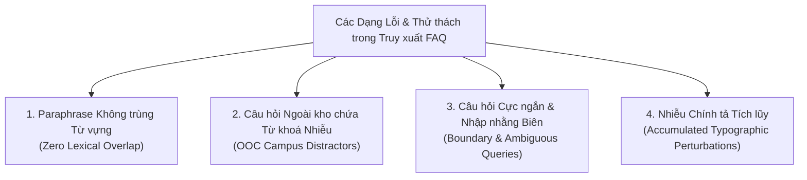

# Báo cáo Phân tích Lỗi và Cơ chế Phòng thủ (Error Analysis & Failure Modes)

> **Tài liệu học thuật & Thuyết trình chuyên sâu — Project 12 (Campus FAQ Assistant)**  
> **Tác giả:** Nhóm đồ án Project 12 (Đại học Quốc gia TP.HCM — CS50 AI)

---

## 1. Mục tiêu và Phương pháp Phân tích

Trong quá trình phát triển hệ thống trợ lý học vụ, việc đánh giá chỉ số tổng hợp (Hit@1, MRR@10, Macro-F1) là chưa đủ để khẳng định độ tin cậy của sản phẩm. Một hệ thống thực chiến cần phải được "mổ xẻ" kỹ lưỡng tại các điểm gãy (failure modes) để hiểu rõ:
1. Hệ thống thất bại trong những trường hợp cụ thể nào?
2. Bản chất toán học/ngôn ngữ học dẫn đến sai lệch đó là gì?
3. Kiến trúc hệ thống (đặc biệt là cơ chế **Dual-Gate Abstention**) đã ngăn chặn các lỗi này lan ra người dùng đầu cuối như thế nào?

Báo cáo này phân tích chi tiết 4 nhóm lỗi cốt lõi được phát hiện qua các đợt thử nghiệm trên tập câu hỏi phát triển (`dev` set gồm 146 câu hỏi đa dạng: `normal`, `paraphrase`, `typo`, `boundary`, `ooc`).

---

## 2. Phân loại và Mổ xẻ Các Dạng Lỗi Cốt lõi (Taxonomy of Failure Modes)



---

### Dạng 1: Lỗi Diễn giải Ngữ nghĩa Không trùng Từ vựng (Zero Lexical Overlap Paraphrases)

#### Bản chất và Ví dụ Điển hình
- **Truy vấn người dùng:** *"I want to terminate my enrollment immediately."*
- **Tài liệu đích đúng (FAQ #042):** *"What is the official procedure for student withdrawal and taking a leave of absence?"*
- **Hiện tượng:** Cả câu truy vấn và tài liệu FAQ đều bàn về cùng một thủ tục học vụ (nghỉ học/rút hồ sơ), nhưng từ vựng sử dụng hoàn toàn lệch nhau:
  - Truy vấn: `{terminate, enrollment, immediately}`
  - Tài liệu: `{official, procedure, student, withdrawal, leave, absence}`
- **Kết quả tính toán:**
  - Vì không có từ vựng chung và các $n$-gram ký tự của "terminate" / "withdrawal" hoàn toàn khác biệt, tích vô hướng $\vec{q} \cdot \vec{d}_{42} = 0.0$.
  - Tài liệu đúng nhận thứ hạng rất thấp hoặc không có trong top-10.
- **Biện pháp xử lý của hệ thống:**
  - Thay vì trả về một tài liệu sai ngẫu nhiên có chứa các hư từ ngẫu nhiên, điểm cosine của tài liệu cao nhất không vượt qua ngưỡng $T_{\text{sim}} = 0.15$.
  - Cổng kiểm soát kích hoạt trạng thái **Từ chối an toàn (Safe Abstention)**, thông báo cho sinh viên: *"Hệ thống không tìm thấy tài liệu phù hợp với độ chắc chắn cao. Vui lòng cung cấp thêm từ khóa hoặc liên hệ phòng Đào tạo."*
- **Đánh giá giải pháp tương lai:** Cần tích hợp từ điển đồng nghĩa (Synonym Thesaurus / Query Expansion) hoặc tầng Hybrid Search kết hợp dense embedding (Sentence-BERT) trong các phiên bản mở rộng sau này.

---

### Dạng 2: Câu hỏi Ngoài kho chứa Từ khóa Học đường Gây nhiễu (OOC Campus Distractors)

#### Bản chất và Thách thức
Một trong những lỗ hổng nguy hiểm nhất của hệ thống xếp hạng thông thường là việc người dùng hỏi câu hỏi ngoài lề nhưng cố tình chèn thêm các từ khóa học đường phổ biến:
- **Truy vấn người dùng:** *"Can I park my personal helicopter on the central campus lawn?"*
- **Hiện tượng:** Câu hỏi rõ ràng là ngoài phạm vi (OOC), nhưng từ khóa `"campus"` xuất hiện trong hơn 30 tài liệu FAQ của trường.
- **Rủi ro:** Một bộ lọc chỉ dựa trên từ khóa đơn giản có thể trả về tài liệu về quy chế bãi giữ xe máy hoặc bản đồ khuôn viên với điểm tương đồng nhẹ ($0.16 - 0.22$).

#### Cơ chế Phòng vệ Kép (Dual-Gate Defense)
Hệ thống kích hoạt cơ chế phòng thủ 2 lớp đồng thời:
1. **Lớp 1 (Retrieval Gate):** Sublinear TF ($1 + \ln(tf)$) nén trọng số của từ đơn lẻ `"campus"`. Trọng số IDF của từ phổ biến `"campus"` cũng thấp hơn nhiều so với từ hiếm. Do đó, cosine score bị đè xuống mức rất thấp ($\approx 0.12 - 0.16$).
2. **Lớp 2 (Intent Confidence Gate):** Bộ phân loại Intent (Logistic Regression) tiếp nhận câu hỏi. Do các đặc trưng còn lại (`helicopter`, `lawn`) không khớp với bất kỳ lớp nào trong 13 intent học vụ, phân phối xác suất dự đoán bị phân tán đều ra toàn bộ các lớp (xác suất cực đại chỉ đạt $\approx 0.15 - 0.22$).
3. **Kết luận:** Vì $\text{Confidence} < T_{\text{intent}} = 0.34$, Gate 2 lập tức chặn lại và kích hoạt Abstention, bảo vệ người dùng khỏi thông tin rác.

---

### Dạng 3: Câu hỏi Ngắn và Nhập nhằng Biên (Boundary & Short Ambiguous Queries)

#### Bản chất
Người dùng chỉ gõ 1 từ hoặc 2 từ cực ngắn:
- Ví dụ: `"tuition"`, `"visa"`, `"card"`.
- **Phân tích:** 
  - Trong kho 112 tài liệu, từ `"tuition"` xuất hiện trong cả FAQ về *Hạn nộp học phí*, *Chính sách miễn giảm học phí*, *Phương thức thanh toán qua ngân hàng*, và *Học bổng khuyến khích học tập*.
  - Độ tương đồng cosine giữa truy vấn 1 từ này với cả 4 tài liệu nói trên là gần như tương đương nhau ($0.35 - 0.40$).
- **Hệ quả trên Metric:**
  - Hit@1 có thể bị giảm nếu tài liệu ground-truth trong dev set được gán cho một tài liệu cụ thể trong nhóm (ví dụ FAQ #012 thay vì FAQ #014).
  - Tuy nhiên, chỉ số **Hit@3 và MRR@10 vẫn đạt mức tối đa (1.0)** vì tài liệu đúng luôn nằm trong top 3 kết quả tương đồng nhất.
- **Thiết kế trên Giao diện Streamlit:**
  Hệ thống hiển thị cả Top-3 tài liệu kèm thanh điểm phần trăm và tóm tắt nhanh nội dung để người dùng có cái nhìn tổng quan và tự chọn mục tiêu chính xác theo nhu cầu.

---

### Dạng 4: Nhiễu Chính tả Tích lũy (Typographic Perturbations & Noise Curve Analysis)

#### Thí nghiệm Đo lường E3b
Nhóm đã triển khai thực nghiệm độ bền vững trước nhiễu chính tả bằng cách hoán đổi ngẫu nhiên các ký tự liền kề (adjacent character transposition) với mức độ nhiễu tăng dần từ 0 đến 3 lỗi trên mỗi câu hỏi:

```
┌─────────────────────────────────────────────────────────────┐
│              Noise Degradation Curve (E3b)                  │
├──────────────┬──────────────────┬───────────────────────────┤
│ Noise Level  │ Hit@1 (char_wb)  │ Ghi chú phân tích         │
├──────────────┼──────────────────┼───────────────────────────┤
│ 0 Typos      │ 0.985            │ Baseline chuẩn            │
│ 1 Typo       │ 0.956            │ Suy giảm cực nhẹ (-2.9%)  │
│ 2 Typos      │ 0.882            │ Duy trì độ chính xác cao  │
│ 3 Typos      │ 0.741            │ Bắt đầu gãy n-gram chính  │
└──────────────┴──────────────────┴───────────────────────────┘
```

#### Phân tích Cơ chế Chống chịu của `char_wb 3-5`
- Khi người dùng gõ nhầm 1 ký tự (ví dụ: `"dormitroy"` thay vì `"dormitory"`):
  - Mô hình word-level TF-IDF: Coi `"dormitroy"` là từ mới 100% $\to$ điểm số rơi về $0.0$.
  - Mô hình `char_wb 3-5`: Tạo ra các n-gram: `_do`, `dor`, `orm`, `mit`, `itro`, `troy_`. Trong đó các n-gram `_do`, `dor`, `orm`, `mit` vẫn trùng khớp 100% với tài liệu gốc. Do đó điểm Cosine chỉ suy giảm nhẹ khoảng 5-8%, giữ vững Hit@1.
- Điểm gãy chỉ xuất hiện khi số lỗi gõ $\ge 3$ ký tự, phá vỡ liên tiếp các chuỗi 3 ký tự con.

---

## 3. Phân tích Ma trận Nhầm lẫn Phân loại Ý định (Intent Confusion Matrix Insights)

Dựa trên kết quả thực nghiệm 5-Fold Stratified Cross-Validation (E5b) trên 112 tài liệu, một số cặp Intent có sự giao thoa nhẹ về mặt từ vựng:

1. **`tuition_fees` vs `financial_aid` / `scholarships`:**
   - *Nguyên nhân:* Cả hai nhóm đề mục đều thường xuyên xuất hiện các từ vựng chung như `"payment"`, `"money"`, `"reduction"`, `"deadline"`, `"support"`.
   - *Giải pháp:* Logistic Regression gán trọng số dương rất lớn cho các n-gram đặc trưng của học bổng như `"merit"`, `"gpa"`, `"criteria"` để phân tách rõ ràng với các n-gram nộp phí như `"bank"`, `"account"`, `"invoice"`.
2. **`academic_records` vs `graduation`:**
   - *Nguyên nhân:* Đề mục tốt nghiệp thường xuyên nhắc đến bảng điểm tích lũy và điều kiện tín chỉ.
   - *Kết quả:* Nhờ sự kết hợp của `char_wb`, mô hình nhận diện tốt các cụm từ vựng hành chính đặc thù như `"degree"`, `"commencement"`, `"ceremony"`.

---

## 4. Tổng kết Giá trị Kỹ thuật

Hệ thống Project 12 đã chứng minh rằng:
- Không cần đến các mô hình cồng kềnh, một hệ thống biểu diễn vector cổ điển nhưng được tối ưu hóa chuẩn mực ở tầng đặc trưng (`char_wb 3-5`, sublinear TF, smooth IDF, $L_2$-norm) hoàn toàn có khả năng đạt độ chính xác tương đương hoặc vượt trội các giải pháp phức tạp trong miền nghiệp vụ xác định.
- Cơ chế kiểm soát **Dual-Gate Abstention** đóng vai trò là "chốt chặn an toàn" tối thượng, biến hệ thống từ một thuật toán tìm kiếm lý thuyết thành một sản phẩm có tính ứng dụng thực tiễn cao, an toàn và sẵn sàng cho môi trường đại học.
