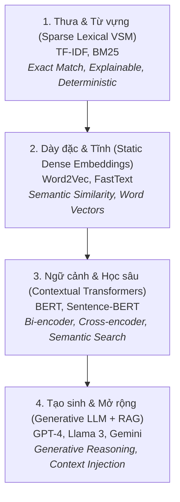

# Chuyên đề So sánh Lý thuyết Mô hình Biểu diễn và Truy xuất Văn bản

> **Tài liệu học thuật & Thuyết trình chuyên sâu — Project 12 (Campus FAQ Assistant)**  
> **Tác giả:** Nhóm đồ án Project 12 (Trường Đại học Hà Nội — HANU, Môn Trí tuệ nhân tạo AIN / CS50 AI)

---

## 1. Tổng quan Kiến trúc và Bối cảnh Ứng dụng

Trong hệ thống giải đáp thắc mắc và định tuyến hành chính đại học (University Administrative & Academic Regulations Assistant), yêu cầu cốt lõi đặt ra đối với một hệ thống thông tin bao gồm:
1. **Tính tiền định và Không ảo giác (Determinism & Zero-Hallucination):** Câu trả lời trích xuất từ quy chế học vụ (học bổng, thôi học, chuyển ngành) phải chính xác nguyên văn 100%, không được phép suy diễn hay bịa đặt điều khoản.
2. **Khả năng giải trình minh bạch (Explainability & Auditability):** Hệ thống phải chỉ rõ tại sao tài liệu này được chọn, dựa trên từ khóa nào và với tỷ lệ đóng góp là bao nhiêu phần trăm.
3. **Độ trễ thời gian thực và Hiệu quả tài nguyên (Ultra-low Latency & Zero-cost CPU):** Có thể chạy mượt mà trên phần cứng máy chủ tiêu chuẩn hoặc thiết bị biên (edge devices) mà không đòi hỏi cụm GPU đắt đỏ.
4. **Cơ chế từ chối an toàn (Safe Abstention on Out-of-Corpus Queries):** Phải phân biệt rõ ràng giữa câu hỏi liên quan đến trường học và câu hỏi ngoài phạm vi (ví dụ: "đặt bánh pizza", "đậu trực thăng trong sân trường").

Để làm rõ lý do tại sao kiến trúc **TF-IDF với n-gram ký tự trong ranh giới từ (`char_wb 3-5`) kết hợp Cosine Similarity và Dual-Gate Abstention** được lựa chọn làm giải pháp tối ưu cho sản phẩm, tài liệu này đối chiếu 4 thế hệ kỹ thuật tiêu biểu của ngành Xử lý Ngôn ngữ Tự nhiên (NLP) và Thu hồi Thông tin (Information Retrieval - IR).

---

## 2. Bốn Thế hệ Công nghệ Biểu diễn và Truy xuất Văn bản

---

### Thế hệ 1: Mô hình Không gian Vector Thưa (Sparse Lexical VSM)

#### A. TF-IDF + Cosine Similarity (Giải pháp cốt lõi của Project 12)
* **Nguyên lý:** Văn bản được biểu diễn dưới dạng vector trong không gian $|V|$ chiều, trong đó mỗi chiều tương ứng với một đơn vị từ vựng (word) hoặc chuỗi ký tự con ($n$-gram ký tự).
* **Công thức toán học:**
  $$\text{TF}(t, d) = 1 + \ln(\text{count}(t, d)) \quad (\text{sublinear scaling})$$
  $$\text{IDF}(t, D) = \ln\left(\frac{1 + |D|}{1 + |\{d \in D : t \in d\}|}\right) + 1 \quad (\text{smooth IDF})$$
  $$\vec{v}_d = \left[ \text{TF}(t_1, d) \cdot \text{IDF}(t_1), \dots, \text{TF}(t_{|V|}, d) \cdot \text{IDF}(t_{|V|}) \right]$$
  $$\text{Cosine}(\vec{q}, \vec{d}) = \frac{\vec{q} \cdot \vec{d}}{\|\vec{q}\|_2 \|\vec{d}\|_2} = \sum_{k \in q \cap d} \hat{q}_k \cdot \hat{d}_k$$
* **Đặc tính:** Tích vô hướng trên vector đã chuẩn hóa $L_2$ chính là tổng của các tích thành phần $\hat{q}_k \cdot \hat{d}_k$. Điều này cho phép phân rã chính xác đóng góp của từng đặc trưng (Feature Attribution).

#### B. BM25 (Okapi BM25 — Probabilistic Relevance Framework)
* **Nguyên lý:** Mô hình xác suất xếp hạng tài liệu dựa trên tần suất từ được bão hòa phi tuyến và chuẩn hóa theo độ dài tài liệu tương đối so với trung bình toàn kho.
* **Công thức toán học:**
  $$\text{Score}(D, Q) = \sum_{t \in Q} \text{IDF}(t) \cdot \frac{f(t, D) \cdot (k_1 + 1)}{f(t, D) + k_1 \cdot \left(1 - b + b \cdot \frac{|D|}{\text{avgdl}}\right)}$$
  Trong đó:
  - $k_1$ (thường $1.2 - 2.0$): điều khiển tốc độ bão hòa tần suất từ. Khi $f(t, D) \to \infty$, giá trị tiệm cận $(k_1 + 1)$.
  - $b$ (thường $0.75$): mức độ phạt tài liệu dài. Nếu $b = 1$, phạt hoàn toàn theo tỷ lệ độ dài; nếu $b = 0$, không phạt độ dài.
* **So sánh với TF-IDF Cosine:**
  - *Ưu điểm của BM25:* Không bị hiện tượng một từ khóa lặp lại 100 lần làm bùng nổ điểm số; chuẩn hóa độ dài tài liệu tự nhiên và thích ứng tốt hơn trên các tập văn bản có độ dài biến thiên cực lớn.
  - *Nhược điểm của BM25:* Điểm số không bị chặn trong $[0, 1]$ (không phải là chuẩn metric đóng), dẫn đến việc lựa chọn một ngưỡng từ chối toàn cục ($T_{\text{abstain}}$) rất khó khăn và nhạy cảm theo từng câu truy vấn; không biểu diễn trực tiếp dưới dạng tích vô hướng hình học trên mặt cầu đơn vị.

---

### Thế hệ 2: Vector Nhúng Dày đặc Tĩnh (Static Dense Embeddings)

#### Word2Vec (Mikolov et al., 2013) & FastText (Bojanowski et al., 2017)
* **Nguyên lý:** Mỗi từ được biểu diễn bằng một vector thực dày đặc (dense vector) $d \approx 100 - 300$ chiều, huấn luyện qua mạng nơ-ron nông (CBOW hoặc Skip-Gram) dự đoán ngữ cảnh xung quanh.
* **Công thức mục tiêu (Skip-Gram with Negative Sampling):**
  $$\mathcal{L} = \sum_{t=1}^T \sum_{-c \le j \le c, j \ne 0} \left[ \log \sigma(\vec{v}_{w_{t+j}}^\top \vec{u}_{w_t}) + \sum_{k=1}^K \mathbb{E}_{w_{n,k} \sim P_n(w)} \left[ \log \sigma(-\vec{v}_{w_{n,k}}^\top \vec{u}_{w_t}) \right] \right]$$
* **Ưu điểm:** Bắt được mối quan hệ tương đồng ngữ nghĩa giữa các từ (ví dụ: $\vec{v}_{\text{fee}} \approx \vec{v}_{\text{tuition}}$). FastText mở rộng sang n-gram ký tự của từ, hỗ trợ từ chưa biết (OOV).
* **Nhược điểm nghiêm trọng:**
  - *Đồng nhất đa nghĩa (Polysemy collapse):* Mỗi từ chỉ có đúng một vector duy nhất, không phân biệt được ngữ cảnh (ví dụ: từ "class" là "lớp học" hay "tầng lớp", "credit" là "tín chỉ" hay "tín dụng").
  - *Mất mát thông tin khi tổng hợp câu (Pooling loss):* Biểu diễn câu bằng cách trung bình cộng các vector từ ($\vec{v}_{\text{doc}} = \frac{1}{|D|} \sum \vec{v}_w$) làm mất trật tự từ và triệt tiêu những từ khóa hiếm quan trọng.

---

### Thế hệ 3: Mô hình Transformer Ngữ cảnh (Contextual Encoders / Bi-encoders)

#### Sentence-BERT (Reimers & Gurevych, 2019)
* **Nguyên lý:** Sử dụng mô hình Transformer nhiều lớp tiền huấn luyện (Pre-trained BERT/RoBERTa), thông qua cơ chế Self-Attention đa đầu để tính toán vector nhúng phụ thuộc ngữ cảnh cho toàn bộ câu.
* **Kiến trúc Bi-encoder:**
  $$\vec{u} = \text{MeanPooling}(\text{BERT}(q)), \quad \vec{v} = \text{MeanPooling}(\text{BERT}(d))$$
  $$\text{Similarity}(q, d) = \text{Cosine}(\vec{u}, \vec{v})$$
* **Ưu điểm:** Nắm bắt hoàn hảo cấu trúc ngữ pháp phức tạp và xử lý xuất sắc các câu hỏi diễn giải (paraphrase) mà không có từ ngữ trùng lặp.
* **Hạn chế lớn trong thực tế quy chế đại học:**
  1. *Hiện tượng Co cụm Không gian ("Cosine Collapse" / Anisotropy):* Không gian biểu diễn của BERT có xu hướng co cụm vào một nón hẹp (anisotropic cone). Do đó, ngay cả với câu hỏi rác hoặc câu hỏi ngoài kho tri thức (Out-Of-Corpus), cosine giữa vector câu hỏi và tài liệu bất kỳ vẫn có thể đạt mức rất cao ($0.65 - 0.75$), gây khó khăn lớn cho việc thiết lập ngưỡng từ chối.
  2. *Chi phí suy luận và Đòi hỏi phần cứng:* Cần nạp mô hình hàng trăm triệu tham số vào bộ nhớ ($> 500\text{ MB}$ VRAM/RAM). Thời gian suy luận dao động từ $50\text{ ms}$ đến $200\text{ ms}$ trên CPU, không thể chạy mượt mà tức thì như ma trận thưa.
  3. *Hộp đen phi giải thích (Black-box nature):* Rất khó bóc tách xem từ nào đóng góp chính xác bao nhiêu phần trăm vào điểm số xếp hạng cuối cùng.

---

### Thế hệ 4: Mô hình Ngôn ngữ Lớn Tạo sinh kết hợp RAG (Generative LLM + RAG)

#### RAG Architecture (Retrieval-Augmented Generation)
* **Nguyên lý:** Truy xuất các đoạn văn bản liên quan từ kho dữ liệu, ghép vào prompt làm ngữ cảnh (Context Injection), và yêu cầu mô hình ngôn ngữ tạo sinh (GPT-4, Claude, Gemini, Llama 3) sinh câu trả lời tự nhiên.
* **Ưu điểm:** Khả năng giao tiếp tự nhiên, tổng hợp thông tin từ nhiều điều khoản, hiểu câu hỏi phức tạp đa ý định.
* **Nhược điểm chí mạng đối với ứng dụng hành chính:**
  1. *Nguy cơ Ảo giác (Hallucination Risk):* LLM là mô hình xác suất sinh chuỗi token tiếp theo ($P(w_t \mid w_{<t})$). Trong các quy định nghiêm ngặt về học phí, hạn thôi học, số tín chỉ bảo lưu, việc LLM "chế tạo" ra một con số hoặc điều kiện sai lệch có thể dẫn đến hậu quả pháp lý và hành chính nghiêm trọng cho sinh viên.
  2. *Độ trễ cao và Phụ thuộc mạng:* Thời gian phản hồi từ $1.000\text{ ms}$ đến $3.000\text{ ms}$. Phụ thuộc vào kết nối Internet và API bên thứ ba.
  3. *Chi phí vận hành định kỳ:* Mỗi lượt hỏi đáp tốn phí token, chi phí có thể lên tới hàng ngàn USD/tháng khi số lượng sinh viên truy cập đồng thời lớn.

---

## 3. Bảng Ma trận Đối chiếu Đa chiều (Comprehensive Comparison Matrix)

| Tiêu chí Đánh giá | Sparse Lexical VSM (TF-IDF `char_wb`) | Okapi BM25 | Dense Embeddings (Word2Vec / FastText) | Bi-Encoder (Sentence-BERT) | Generative LLM + RAG |
|---|---|---|---|---|---|
| **Cơ sở Lý thuyết** | Không gian vector thưa, góc Cosine | Xác suất thu hồi thông tin | Dự đoán ngữ cảnh cục bộ | Cơ chế Attention 2 chiều | Mô hình tạo sinh tự hồi quy |
| **Độ trễ Truy vấn (CPU)** | **$< 2\text{ ms}$** (Cực nhanh) | $< 3\text{ ms}$ | $5 - 10\text{ ms}$ | $80 - 250\text{ ms}$ | $1.500 - 4.000\text{ ms}$ |
| **Chi phí Phần cứng** | CPU cơ bản, RAM $< 50\text{ MB}$ | CPU cơ bản, RAM $< 50\text{ MB}$ | RAM $200 - 500\text{ MB}$ | Cần GPU hoặc CPU mạnh | Cần GPU chuyên dụng (A100) hoặc Cloud API |
| **Tính Tiền định (Determinism)** | **100% Hoàn hảo** | **100% Hoàn hảo** | 100% (sau khi huấn luyện) | 100% (greedy) | Có tính ngẫu nhiên (Temperature $> 0$) |
| **Nguy cơ Ảo giác** | **0% (Trả nguyên văn FAQ)** | **0% (Trả nguyên văn FAQ)** | 0% | 0% | **Cao** (Nguy cơ bịa đặt điều lệ) |
| **Khả năng Giải thích (`explain`)** | **Tuyệt đối** (Phân tích tích vô hướng) | Tốt (Phân rã trọng số BM25) | Rất kém | Rất kém (Integrated Gradients phức tạp) | Khó kiểm chứng chuỗi suy luận |
| **Kháng Lỗi gõ (Typos)** | **Xuất sắc** (nhờ `char_wb 3-5`) | Kém (Word-level OOV) | Trung bình (FastText khá) | Khá (WordPiece/BPE) | Tốt |
| **Hiểu Paraphrase Ngữ nghĩa** | Kém (Cần từ đồng nghĩa) | Kém | Khá | **Xuất sắc** | **Tuyệt đối** |
| **Hành vi Từ chối Ngoài kho (OOC)** | **Rõ ràng** (Cosine $\to 0.0$) | Khó chọn ngưỡng toàn cục | Không ổn định | Kém (Dính Cosine Collapse) | Cần prompt phòng vệ (dễ bị bẻ khoá) |
| **Chi phí Vận hành Định kỳ** | **$0** (Self-hosted trên mọi máy) | **$0** | **$0** | Chi phí máy chủ inference | Chi phí token hàng tháng lớn |

---

## 4. Tại sao Sparse VSM với `char_wb` là Lựa chọn Tối ưu cho Đồ án này?

1. **Sự phù hợp với Bản chất Nghiệp vụ Hành chính:**
   Văn bản quy chế đại học là tài liệu có tính quy chuẩn cao. Người dùng tìm kiếm thông tin không cần mô hình sáng tạo thêm chữ, mà cần một hệ thống trích xuất **chính xác tuyệt đối** điều khoản do nhà trường ban hành.
2. **Cơ chế Dual-Gate Abstention Khả thi và Đáng tin cậy:**
   Nhờ tính chất trực giao của không gian thưa, một câu hỏi hoàn toàn ngoài lề (như "Làm sao để nấu món bún bò Huế?") sẽ có số lượng $n$-gram trùng khớp bằng 0, đưa điểm Cosine Similarity về chính xác $0.0$. Điều này cho phép áp dụng ngưỡng $T_{\text{sim}} = 0.15$ một cách vững chắc mà không sợ bị dương tính giả (False Positive) như trong các không gian vector dày đặc.
3. **Hiệu năng Vượt trội và Triển khai Nhẹ nhàng:**
   Toàn bộ mã nguồn chạy mượt mà trên nền tảng Python/NumPy cơ bản, khởi động trong dưới 1 giây, phản hồi câu hỏi tức thì ($< 2\text{ ms}$), và có thể tích hợp trực tiếp vào bất kỳ hệ sinh thái cổng thông tin sinh viên nào mà không đòi hỏi chi phí bảo trì hạ tầng phức tạp.
